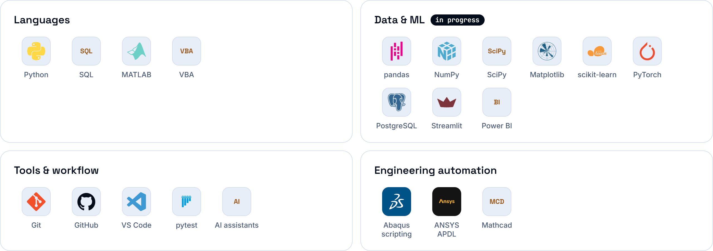
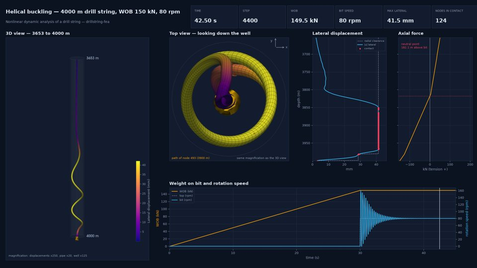
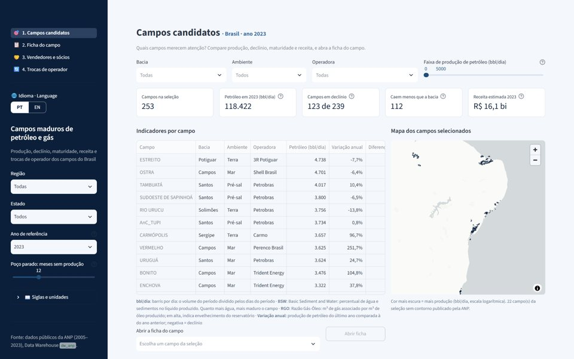

<a href="https://aguiarln.github.io">
<picture>
  <source media="(prefers-color-scheme: dark)" srcset="assets/banner-dark-v2.png">
  
</picture>
</a>

  <picture>
    <source media="(prefers-color-scheme: dark)" srcset="assets/typing-dark.svg">
    
  </picture>

<b>English</b> · <a href="https://github.com/aguiarln/aguiarln/blob/main/README.pt-BR.md">Português</a>

### About me

I'm a civil engineer from UFS, but it was during my **M.Sc. in Mechanical Engineering at PUC-Rio** that I really got hooked on code: I wrote a finite element program to simulate the dynamics of oil-well drill strings.

Since 2021 I've brought that to **TechnipFMC**, where I design and analyze subsea structures (PLETs, rigid jumpers, in-line structures) on large EPCI contracts for Petrobras and TotalEnergies, and automate whatever I can with Python.

Now, through **PUC-Rio's BI Master**, I'm adding data and AI to that toolbox.

### Stack

<picture>
  <source media="(prefers-color-scheme: dark)" srcset="assets/stack-dark-v2.png">
  
</picture>

### Featured projects

<table>
  <tr>
    <td width="50%" valign="top">
      
       <b><a href="https://github.com/aguiarln/drillstring-fea">drillstring-fea</a></b> · M.Sc. · PUC-Rio
       Nonlinear dynamic FEA of oil-well drill strings: 3D corotational beams, Newton-Raphson, Newmark integration and wall contact. Reproduces the dissertation's results with automated tests.
    </td>
    <td width="50%" valign="top">
      
       <b><a href="https://github.com/aguiarln/anp-oil-gas-dw">anp-oil-gas-dw</a></b> · BI Master · PUC-Rio
       Reproducible BI pipeline on Brazil's public oil &amp; gas data (2005–2023): PostgreSQL stage, Python ETL, star-schema Data Warehouse and a bilingual Streamlit dashboard.
    </td>
  </tr>
</table>

### Find me

  <a href="https://aguiarln.github.io/cv/Luiz_Aguiar_Neto_CV_EN.pdf"><picture><source media="(prefers-color-scheme: dark)" srcset="assets/btn-cv-dark-v2.png"></picture></a>
  <a href="https://www.linkedin.com/in/aguiarluizneto/"><picture><source media="(prefers-color-scheme: dark)" srcset="assets/btn-linkedin-dark-v2.png"></picture></a>
  <a href="mailto:aguiarluizneto@hotmail.com"><picture><source media="(prefers-color-scheme: dark)" srcset="assets/btn-email-dark-v2.png"></picture></a>

