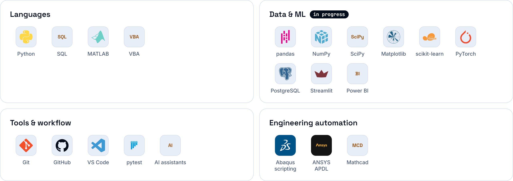
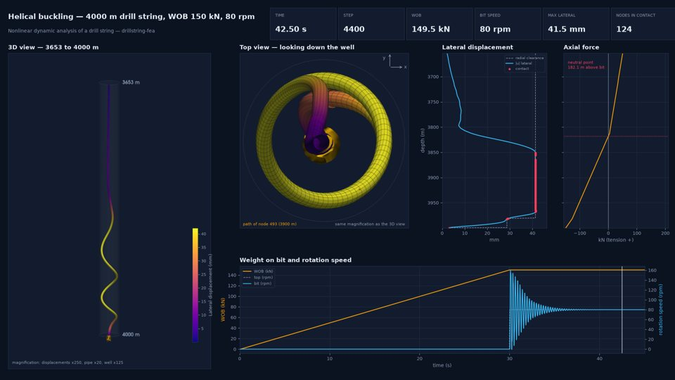
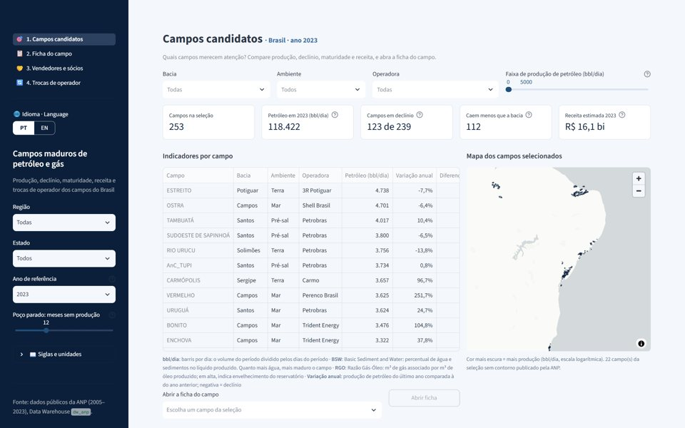

<picture>
  <source media="(prefers-color-scheme: dark)" srcset="assets/banner-dark.png">
  
</picture>

<a href="https://github.com/aguiarln">English</a> · <b>Português</b>

### Sobre mim

Sou engenheiro civil pela UFS, mas foi no **mestrado em Engenharia Mecânica na PUC-Rio** que me encontrei de vez com o código: escrevi um programa de elementos finitos para simular a dinâmica de colunas de perfuração.

Desde 2021 levo isso para a **TechnipFMC**, onde projeto e analiso estruturas submarinas (PLETs, jumpers rígidos, estruturas in-line) em grandes contratos EPCI para Petrobras e TotalEnergies, e automatizo o que der com Python.

Agora, no **BI Master da PUC-Rio**, estou somando dados e IA a essa caixa de ferramentas.

### Stack

<picture>
  <source media="(prefers-color-scheme: dark)" srcset="assets/stack-dark.png">
  
</picture>

### Projetos em destaque

<table>
  <tr>
    <td width="50%" valign="top">
      
       <b><a href="https://github.com/aguiarln/drillstring-fea">drillstring-fea</a></b> · Mestrado · PUC-Rio
       Análise dinâmica não linear por elementos finitos de colunas de perfuração: vigas corrotacionais 3D, Newton-Raphson, integração de Newmark e contato com a parede do poço. Reproduz os resultados da dissertação com testes automáticos.
    </td>
    <td width="50%" valign="top">
      
       <b><a href="https://github.com/aguiarln/anp-oil-gas-dw">anp-oil-gas-dw</a></b> · BI Master · PUC-Rio
       Pipeline de BI reprodutível sobre os dados públicos de óleo e gás da ANP (2005–2023): stage em PostgreSQL, ETL em Python, Data Warehouse em esquema estrela e painel bilíngue em Streamlit.
    </td>
  </tr>
</table>

### Contato

  
  
  

